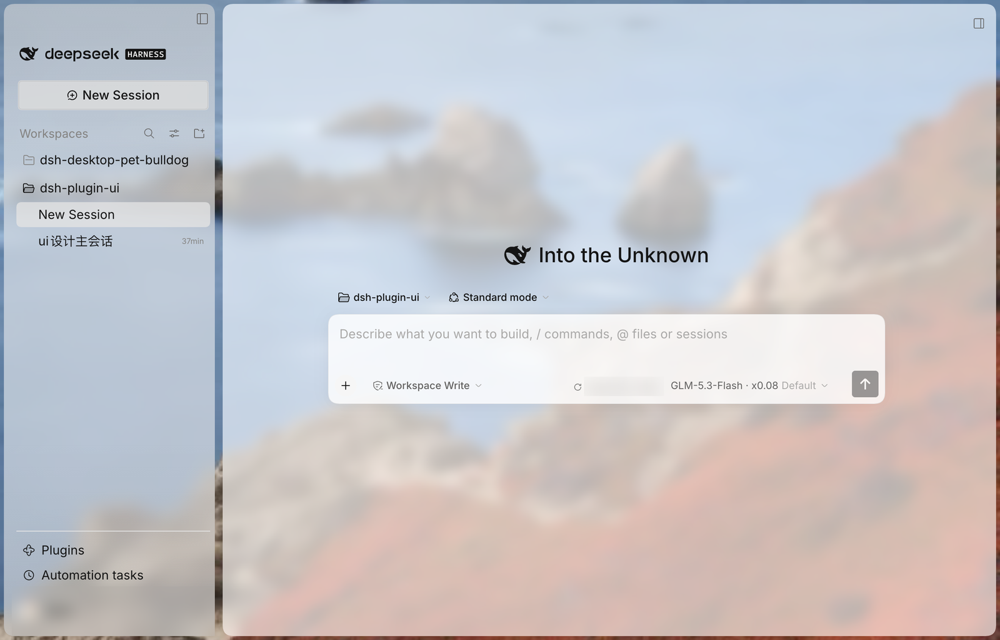
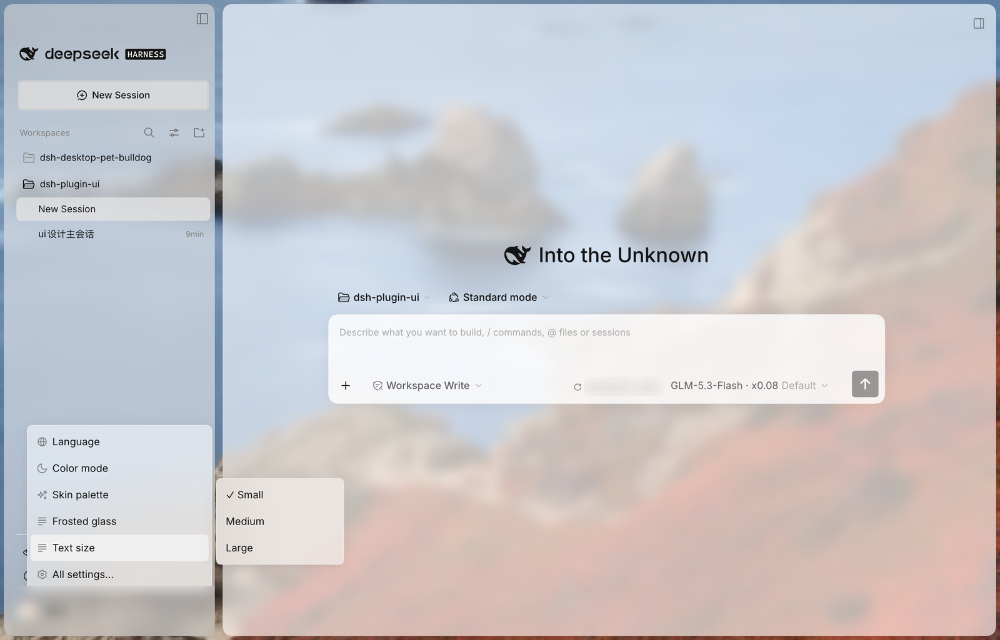

# dsh-plugin-ui

**简体中文** | [English](README.en.md)

为 DeepSeek Harness 注入皮肤界面：毛玻璃与壁纸地面、四套皮肤配色、单卡模型/推理强度选择器、账号快捷设置。客户端插件，不修改 core。皮肤配色参考 Qoder 的配色方案。

## 界面

| 浅色 | 深色 |
| --- | --- |
|  |  |

*图中账号信息已遮挡。*

## 功能

### 毛玻璃与壁纸

侧栏与工作区两栏浮在可选壁纸的“底板”上，文字表面（输入框、气泡、代码卡、浮层、状态徽标、选中的行等）按实测对比度分层结霜。玻璃强度在快捷设置里四档（关闭 / 轻 / 中 / 强），完整设置里可用 0–1 滑杆细调；底板壁纸内置 25 张预设（4 张纯色、8 张渐变、13 张照片），支持自定义图片、按间隔自动轮换与一键随机换一张。完整设置里的壁纸面板按 macOS 系统设置的版式排布：大预览图旁是随机、轮换间隔与显示范围开关，下方按类型分货架；“在所有区域显示”关掉时壁纸只铺工作区，侧栏退回自己的实色。玻璃与壁纸独立于皮肤配色，随时关回实心。


### 皮肤配色

四套皮肤配色（森林 / 薄荷 / 蜜黄 / 羊皮，即 Forest / Mint / Bee / Parchment，明暗各一版）加“原色”（只保留应用配色，布局仍为插件样式）。在外观下用预览卡切换，快捷菜单的“皮肤配色”分栏是同一个设置；配色只换颜色，不换布局。


### 模型与强度

单卡展示模型列表与推理强度（关闭 / 低 / 高 / 最高），内置搜索、重试与空状态；中文界面本地化强度名。悬停某行时左侧介绍卡跟随该行、顶边对齐；点模型或点强度都算确认，卡片立即收起，触发按钮当场显示新选择。


### 侧栏与字号

中栏 5px 外边距、16px 圆角，工作区/会话行收紧；顶部品牌行与新会话按钮保持官方设计，插件 / 自动化任务固定在账号行上方。文字大小（小 / 中 / 大 = 12 / 14 / 16px）同一设置所有界面同值，账号行的用户名同步缩放。



### 账号行与快捷设置

账号行保持官方 24px 头像 / 44px 行高，右侧两个可配置快捷座位。齿轮座位打开快捷设置：全部设置、语言、颜色模式、皮肤配色、毛玻璃、随机换一张壁纸、文字大小；账号菜单与官方一致（设置、联系我们、登录/退出）。



## 安装

`dist/` 已提交，无需构建。用仓库地址安装：

- 桌面版：插件页 → 添加插件（Add plugin）→ `git@github.com:leonty1/dsh-plugin-ui.git` → Install → Enable now → 重启应用。
- Web：`dsh plugin --profile web add git@github.com:leonty1/dsh-plugin-ui.git`。

卸载：插件页，或 `dsh plugin --profile <profile> remove dsh-plugin-ui`。

## 配置

- 外观 → **皮肤配色**：预览卡选择配色，默认森林。
- 外观 → **毛玻璃 / 底板壁纸**：玻璃强度 0–1 滑杆；壁纸预设、自定义图片、自动轮换、随机换一张、显示范围。
- 通用设置 → **快捷操作位置 1/2**：两个座位可选内置动作、其他插件注册的动作，或留空。
- 存储：`dsh-plugin-ui.palette`（配色）、`dsh-plugin-ui.glass`（玻璃强度）、`dsh-plugin-ui.wallpaper` / `.custom` / `.every` / `.rotatedAt` / `.scope`（底板壁纸、轮换与显示范围）、`dsh-plugin-ui.quick-actions.v1`（两个座位）。

## 其他插件接入

账号行座位是 list 座位 `pluginUi.quickAction`。其他客户端插件注册后，动作会自动出现在快捷操作下拉；选中即渲染该组件，卸载后座位变空、id 保留。

```jsx
// ExportSeat 是插件自己的按钮组件，完整示例见 docs/quick-actions.md
ctx.slots.inject('pluginUi.quickAction', () => ctx.slots.register({
  name: 'pluginUi.quickAction',
  id: 'my-plugin/export',
  label: 'Export',
}, ExportSeat))
```

座位组件填满 30px × 整行高的单元格，用透明按钮和 14–16px 单色图标。`id` 全局唯一，内置 id 保留；完整约定见 [docs/quick-actions.md](docs/quick-actions.md)。

## 开发

```sh
pnpm install
pnpm build   # 生成配色与 dist/
pnpm check   # 构建 + 语法 + 皮肤契约 + 类型检查
```

改外观前先读 [docs/design-invariants.md](docs/design-invariants.md)：其中
「原色只换颜色、不换布局」等约定是硬性要求，`pnpm check` 会校验。

## 实测

- Web（Chromium）：四套配色、原色、暗色、模型列表与切换、强度切换、搜索与空状态。
- 桌面版（官方 0.2.1-rc.3）：安装、模型/强度菜单、官方账号行与快捷座位、侧栏字号 12/14/16px、新会话悬停键帽、设置预览卡；毛玻璃与壁纸浅色、深色模式真机目测通过（强度“强”加亮色壁纸下深色模式文字对比度靠向极限，属滑杆后半段的已知取舍）；壁纸面板（mac 版式、纯色行、随机换一张、轮换间隔、显示范围开关）与快捷设置里的随机换一张均在真机点过，中英文都验过；第三方动作注册实测通过。rc.3 新增的侧栏 More 行与其浮层菜单经真机验证零改动自动跟上（行样式/钉位/结霜均由既有选择器与壳浮层原语覆盖）。
- 未实测：真实账号的成功登录与退出确认。

## 仓库与许可

`git@github.com:leonty1/dsh-plugin-ui.git` · MIT © 2026 Tongyi Liang，见 [LICENSE](LICENSE)。
