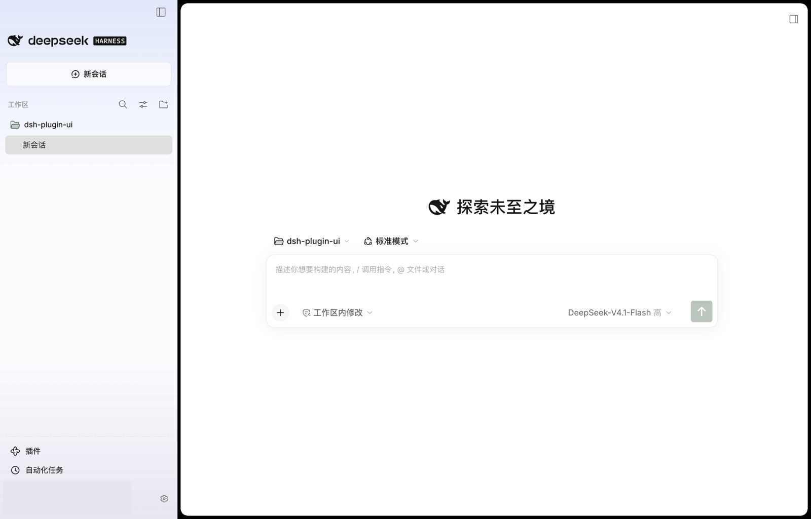
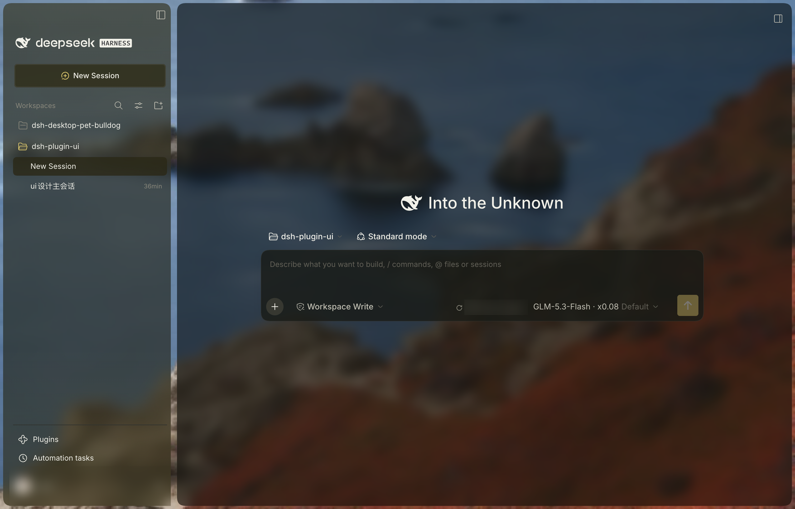
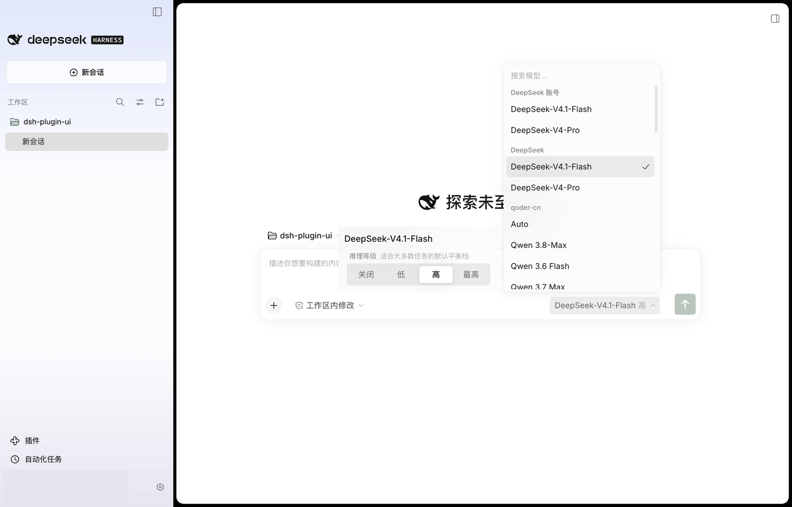
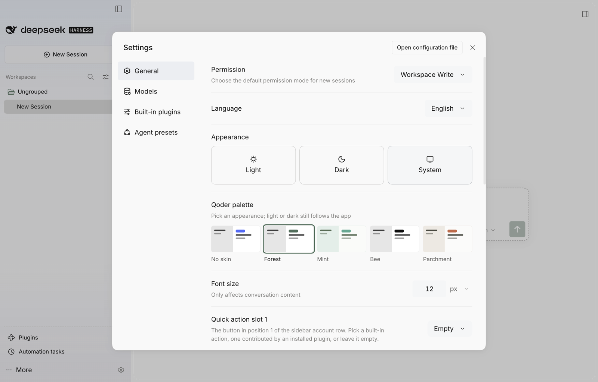

# dsh-plugin-ui

**简体中文** | [English](README.en.md)

为 DeepSeek Harness 注入配色皮肤界面：四套皮肤配色、单卡模型/推理强度选择器、账号快捷设置。客户端插件实现，不修改 core。皮肤配色参考 Qoder 的配色方案。

## 展示

| 浅色 | 深色 |
| --- | --- |
|  |  |





*图中账号信息已遮挡。*

## 功能

- **外观**：四套皮肤配色（森林 / 薄荷 / 蜜黄 / 羊皮，即 Forest / Mint / Bee / Parchment，明暗各一版），在外观下用预览卡切换，也可从快捷设置菜单的“皮肤配色”分栏切换，可选“原色”（只保留应用配色，布局仍为插件样式）；其他配色下侧栏底色跟随所选配色。
- **侧栏**：中栏 5px 外边距、16px 圆角；工作区/会话行收紧到 30px 起；顶部品牌行与新会话按钮保持官方设计；插件 / 自动化任务固定在账号行上方，实线分隔。
- **字号**：侧栏文字（含账号行的用户名）跟随文字大小（小/中/大 = 12/14/16px），新会话按钮同步缩放；账号行保留官方 44px / 32px 行高与 24px 头像。
- **模型与强度**：单卡展示模型列表与强度（关闭 / 低 / 高 / 最高），支持搜索、重试与空状态；中文界面本地化强度名。悬停某行时左侧介绍卡跟随该行、顶边与该行对齐；点模型或点强度都算确认，卡片立即收起，触发按钮当场显示新选择，网络往返只体现在转圈上。
- **账号行（仅桌面版）**：官方 24px 头像 / 44px 行高，未登录为 ⋯ + “更多”；右侧两个可配置快捷座位。
- **账号菜单（仅桌面版）**：与官方一致（设置、联系我们、登录/退出）；快捷设置由齿轮座位打开，含语言、颜色模式、皮肤配色、文字大小与完整设置入口。

## 安装

`dist/` 已提交，无需构建。用仓库地址安装：

- 桌面版：插件页 → 添加插件（Add plugin）→ `git@github.com:leonty1/dsh-plugin-ui.git` → Install → Enable now → 重启应用。
- Web：`dsh plugin --profile web add git@github.com:leonty1/dsh-plugin-ui.git`。

卸载：插件页，或 `dsh plugin --profile <profile> remove dsh-plugin-ui`。

## 配置

- 外观 → **皮肤配色**：预览卡选择配色，默认森林；快捷设置菜单的“皮肤配色”分栏与预览卡是同一个设置。
- 通用设置 → **快捷操作位置 1/2**：两个座位可选内置动作、其他插件注册的动作，或留空。
- 存储：`dsh-plugin-ui.palette`（配色）、`dsh-plugin-ui.quick-actions.v1`（两个座位）。

## 其他插件接入

账号行座位是 list 座位 `pluginUi.quickAction`。其他客户端插件注册后，动作会自动出现在快捷操作下拉；选中即渲染该组件，卸载后座位变空、id 保留。

```jsx
// ExportSeat 是插件自己的按钮组件，完整示例见 docs/quick-actions.md
ctx.slots.inject('pluginUi.quickAction', () => ctx.slots.register({
  name: 'pluginUi.quickAction',
  id: 'my-plugin/export',
  label: 'Export',
}, ExportSeat))
```

座位组件填满 30px × 整行高的单元格，用透明按钮和 14–16px 单色图标。`id` 全局唯一，内置 id 保留；完整约定见 [docs/quick-actions.md](docs/quick-actions.md)。

## 开发

```sh
pnpm install
pnpm build   # 生成配色与 dist/
pnpm check   # 构建 + 语法检查
```

## 实测

- Web（Chromium）：四套配色、原色、暗色、模型列表与切换、强度切换、搜索与空状态。
- 桌面版（官方 0.2.1-rc.2）：安装、模型/强度菜单、官方账号行与快捷座位、侧栏字号 12/14/16px、新会话悬停键帽、设置预览卡；第三方动作注册实测通过。
- 未实测：真实账号的成功登录与退出确认。

## 仓库与许可

`git@github.com:leonty1/dsh-plugin-ui.git` · MIT © 2026 Tongyi Liang，见 [LICENSE](LICENSE)。
